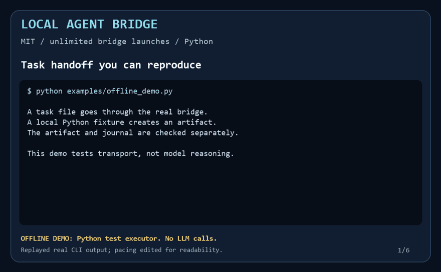

# Демонстрация без вызова модели



Это воспроизводимая демонстрация реальной командной строки моста. Вместо
OpenCode настроен локальный тестовый исполнитель на Python. Он получает файл,
вычисляет `27 × 14`, сохраняет `result.json` и завершается. Демонстрация отдельно
проверяет значение `378` и записи `handoff`/`result` в доске.

```powershell
python examples/offline_demo.py
```

OpenCode, вход к провайдеру и сеть для этого примера не нужны. Скрипт работает
в собственной временной папке. Настройки установленного OpenCode и локальный
конфиг моста он не меняет.

В GIF и MP4 показан вывод выполненных CLI-команд; темп показа изменён для чтения.
Это проверка транспорта, а не запись рассуждений Codex или генерации OpenCode.
Вызовы моделей в этой демонстрации отсутствуют.

Для настоящего запуска OpenCode используйте обычную команду `bridge send`,
как описано в [README](../README.md#первая-задача). Условия выбранного провайдера
и действующие разрешения остаются применимыми.

## Повторная сборка ролика

Для необязательного инструмента разработки `tools/render_demo.py` нужны Pillow
и FFmpeg. Сам мост и CLI-демонстрация используют стандартную библиотеку Python.

```powershell
python tools/render_demo.py
```

Выходные файлы: `assets/demo.gif`, `assets/demo-poster.png`, а также MP4 и
машиночитаемый протокол в исключённой из Git папке `dist/`.

## English

This is a reproducible offline transport demo. A real bridge subprocess hands
a task file to a local Python test executor, which writes an output artifact.
The demo verifies both the arithmetic result and the lifecycle records.
It never calls an LLM, requires no provider login, and uses an isolated temporary
directory. The GIF/MP4 replays captured CLI output with edited pacing.

Run `python examples/offline_demo.py` to reproduce it. For a real OpenCode task,
follow the regular `bridge send` instructions in the README.
